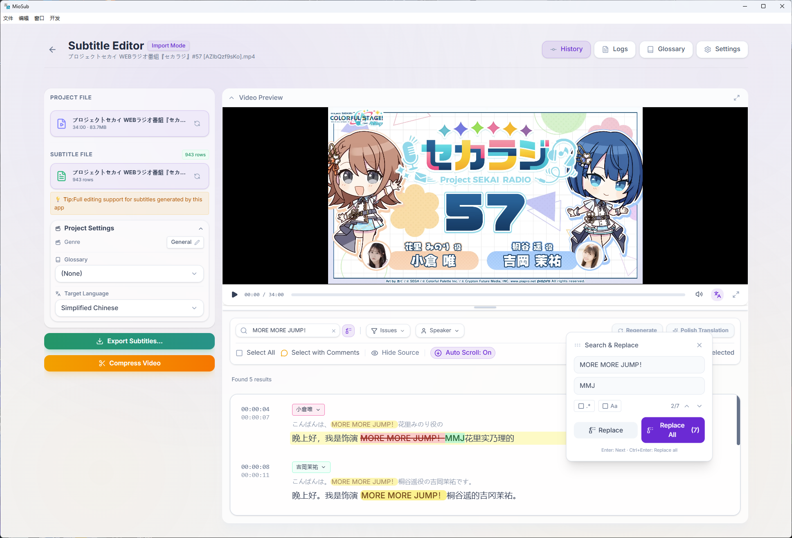

<div align="center">
  

  <h1>MioSub</h1>
  <p><em>formerly Gemini-Subtitle-Pro</em></p>

  <p><strong>World's content, your language.</strong></p>
  <p>The AI subtitle editor that actually understands context</p>

  <p>
    <a href="https://miosub.app/en/docs">📖 Docs</a> ·
    <a href="https://demo.miosub.app">🚀 Live Demo</a> ·
    <a href="https://github.com/corvo007/Gemini-Subtitle-Pro/releases">📥 Download</a> ·
    <a href="https://github.com/corvo007/Gemini-Subtitle-Pro/issues">🐛 Report Issue</a> ·
    <a href="../README.md">🌐 中文</a>
  </p>

  <p>
    <a href="https://github.com/corvo007/Gemini-Subtitle-Pro/stargazers"></a>
    <a href="https://github.com/corvo007/Gemini-Subtitle-Pro/releases"></a>
    <a href="https://github.com/corvo007/Gemini-Subtitle-Pro/releases"></a>
    <a href="https://github.com/corvo007/Gemini-Subtitle-Pro/actions"></a>
    <a href="https://github.com/corvo007/Gemini-Subtitle-Pro/blob/main/LICENSE"></a>
    <a href="https://deepwiki.com/corvo007/Gemini-Subtitle-Pro"></a>
  </p>

  <p>
    
    
    
    
  </p>
</div>

---

## Still proofreading machine translations line by line?

Traditional subtitle tools make you jump between "transcription", "translation", "proofreading", and "timeline sync" endlessly.

**MioSub is different.** Paste a link, grab a coffee, come back to a finished product.

---

## v3.0 Highlights

| Feature                                | Description                                                                                  |
| :------------------------------------- | :------------------------------------------------------------------------------------------- |
| **Timeline Alignment, Out of the Box** | Built-in CTC aligner with millisecond precision, no more tedious external tool configuration |
| **Brand New Interface**                | Editor and settings panel completely redesigned - cleaner, smoother, more powerful           |
| **Not Just Video**                     | Podcasts, radio, audiobooks - pure audio files can be processed directly                     |
| **Clearer CJK Rendering**              | Built-in NotoSans font, no more missing characters or boxes                                  |

> Upgrading from v2.x? Check the [Migration Guide](https://miosub.app/en/docs/guide/migration)

---

## Core Features

|       Category       | Highlights                                                             |
| :------------------: | ---------------------------------------------------------------------- |
|   ⚡ **Efficient**   | **30-min video → 8-min output**, sip coffee while waiting              |
|    🎯 **Precise**    | Auto glossary extraction · Millisecond alignment · Auto speaker labels |
| 🌍 **Multilingual**  | EN/CN/JP interface, supports 100+ language pairs                       |
|  🚀 **Fully Auto**   | Paste link → Auto output, zero intervention needed                     |
|    🖥️ **Editor**     | Edit while watching, real-time subtitle preview                        |
| 📦 **Import/Export** | SRT/ASS import, bilingual export, one-click hardcoding                 |

---

## Interface Preview

<div align="center">
  
  <p><em>Real-time subtitle preview · Auto-scroll · Speaker labels · Floating player · Search & Replace</em></p>
</div>

---

## Showcase

**One-shot generation, no manual proofreading:**

| Type                 | Link                                                         | Description                                                                             |
| :------------------- | :----------------------------------------------------------- | :-------------------------------------------------------------------------------------- |
| 🎙️ Voice Actor Radio | [BV1XBrsBZE92](https://www.bilibili.com/video/BV1XBrsBZE92/) | Japanese 30min, with speaker labels                                                     |
| 🚃 Railway Vlog      | [BV1k1mgBJEEY](https://www.bilibili.com/video/BV1k1mgBJEEY/) | Japanese 29min, lots of technical terminology                                           |
| 🎬 Movie Commentary  | [BV1MG6CBvEzd](https://www.bilibili.com/video/BV1MG6CBvEzd/) | PJSK movie easter eggs, fast Yukuri narration, many character/group/producer/song names |

---

## Quick Start

### System Requirements

| Platform | Version                     |
| :------- | :-------------------------- |
| Windows  | 10/11 (64-bit)              |
| macOS    | 12+ (Intel / Apple Silicon) |
| Linux    | x64 / arm64 (AppImage)      |

Also requires 4GB+ available RAM and network connection.

### 3 Steps to Get Started

1. **Download** — Visit [Releases](https://github.com/corvo007/Gemini-Subtitle-Pro/releases), choose the installer for your platform
2. **Configure** — Open Settings, enter your Gemini API Key. For local Whisper, see [full documentation](https://miosub.app/en/docs/guide/whisper)
3. **Start** — Paste a video link or import a local file

> **Tips**:
>
> - API Key must support **Gemini 2.5/3 Flash** and **Gemini 3 Pro** models

---

## Advanced Configuration

For local Whisper, timeline alignment, video download, and other advanced features, see [📖 Full Documentation](https://miosub.app/en/docs/guide).

---

## 🚀 Local Development

**Prerequisites**: Node.js 18+

```bash
# Install dependencies
yarn install

# Run the app
yarn electron:dev

# Build the app
yarn electron:build
```

After building, find the installer in the `release` directory.

---

## Contribute & Support

Found a bug? Have a great idea?

- [Report Issues](https://github.com/corvo007/Gemini-Subtitle-Pro/issues) — We take every issue seriously
- [Submit PR](https://github.com/corvo007/Gemini-Subtitle-Pro/pulls) — Contributions welcome
- Like it? Give us a Star to help others discover this project

---

## Credits

[Google Gemini](https://deepmind.google/technologies/gemini/) · [OpenAI Whisper](https://openai.com/research/whisper) · [whisper.cpp](https://github.com/ggerganov/whisper.cpp) · [yt-dlp](https://github.com/yt-dlp/yt-dlp) · [FFmpeg](https://ffmpeg.org/) · [Electron](https://www.electronjs.org/)

---

## Star History

[](https://star-history.dera.page/#corvo007/Gemini-Subtitle-Pro&Date)

---

This project is open source under [AGPL-3.0 License](../LICENSE)

<sub>Made with ❤️ for subtitle creators worldwide</sub>

---

<details>
<summary>🔍 SEO Keywords</summary>

**Primary Keywords**: `AI subtitle generator` · `automatic subtitles` · `video translation software` · `Gemini AI translation` · `subtitle editor` · `speech to text` · `video transcription` · `bilingual subtitles` · `YouTube auto captions` · `auto caption generator` · `Whisper transcription` · `forced alignment` · `subtitle timing sync` · `Gemini-Subtitle-Pro` · `MioSub`

**Use Case Keywords**: `fansub tool` · `anime subtitle maker` · `video localization` · `subtitle translator` · `video to text` · `hardcoded subtitles` · `burn in subtitles` · `SRT editor` · `ASS subtitle editor` · `podcast transcription` · `audiobook subtitles`

**Competitor Keywords**: `CapCut alternative` · `VEED alternative` · `Descript alternative` · `Kapwing alternative` · `free subtitle generator` · `best AI subtitle tool 2026` · `subtitle generator no watermark`

**Long-tail Keywords**: `how to add subtitles to video automatically` · `translate YouTube video subtitles` · `generate bilingual subtitles free` · `AI video transcription tool` · `millisecond subtitle sync`

</details>
